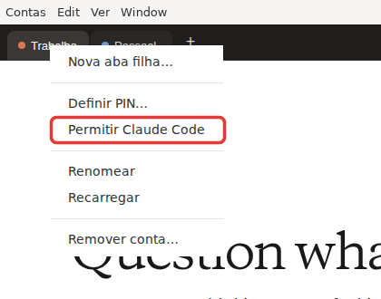
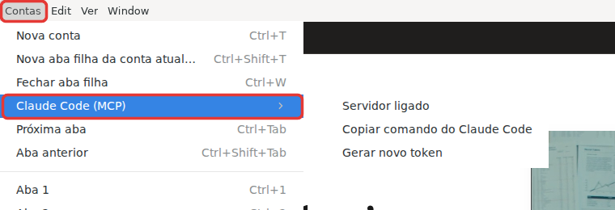
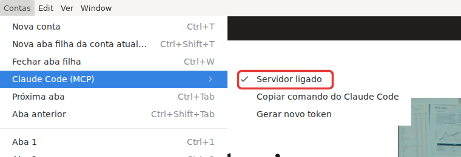
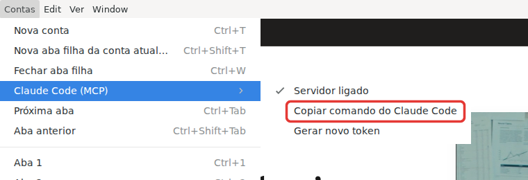
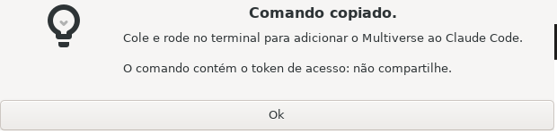
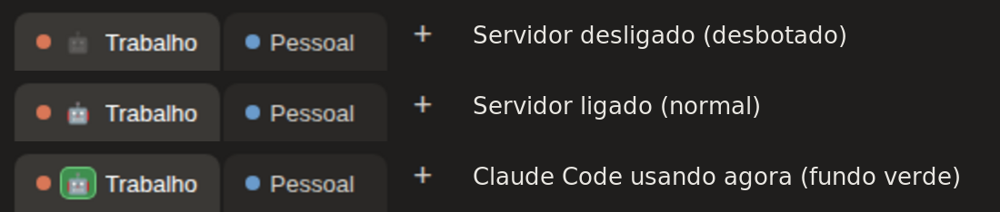
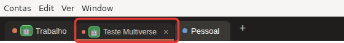
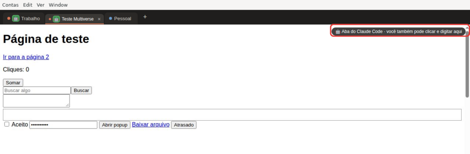
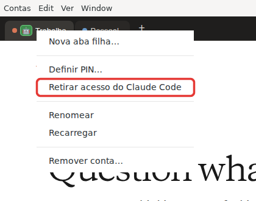

# Usar o Claude Code com o Multiverse

O Claude Code pode **usar as contas do Multiverse como um navegador**, já logado em cada uma: abrir páginas, ler, clicar, digitar e tirar prints. Você escolhe quais contas ele enxerga.

Ele trabalha em **abas próprias**, em segundo plano. Você continua usando o Multiverse, ou outro programa, normalmente, e ele segue trabalhando **mesmo com o Multiverse minimizado**.

São três passos, feitos **uma vez só**:

1. Liberar a conta (na aba).
2. Ligar o servidor (no menu **Contas**).
3. Registrar o Multiverse no Claude Code (no terminal).

> Os prints são da versão Linux. No Windows e no Mac as telas são iguais, só muda a aparência dos menus.

---

## 1. Liberar a conta

Clique com o **botão direito** na aba da conta → **Permitir Claude Code**.



Aparece um 🤖 na aba. Pode liberar quantas contas quiser: repita em cada uma.

> Isso só marca a conta. Ainda não conecta nada.

---

## 2. Ligar o servidor

O **menu Contas** é a primeira palavra da barra no alto da janela, acima das abas (**Contas · Edit · Ver · Window**). No Mac, ela fica na barra do topo da tela.

Clique em **Contas** e passe o mouse em **Claude Code (MCP)**:



Clique em **Servidor ligado**. Fica um ✓ ao lado.



> Se o Windows perguntar sobre o firewall, pode **negar** a rede pública. O servidor só atende o próprio computador.

---

## 3. Registrar no Claude Code

No mesmo menu, clique em **Copiar comando do Claude Code**:



Aparece a confirmação:



Abra um terminal (PowerShell, Terminal do Mac ou o terminal do VS Code), cole com **Ctrl+V** (no Mac, **⌘V**) e tecle **Enter**. O comando é parecido com:

```
claude mcp add --transport http multiverse http://127.0.0.1:47821/mcp --header "Authorization: Bearer ..."
```

Para conferir, rode:

```
claude mcp list
```

Deve aparecer **multiverse**.

> O comando contém uma senha (token). Não compartilhe.

---

## Pronto: como usar

Abra uma conversa **nova** no Claude Code e peça, por exemplo:

- *"Liste as contas do Multiverse."*
- *"Na conta Trabalho, abra github.com e me diga quais notificações eu tenho."*
- *"Na conta Pessoal, entre em claude.ai/projects, abra o projeto X e leia as instruções."*
- *"Leia a aba da conta Trabalho."* (a aba da própria conta ele só lê)

Ele identifica as contas **pelo nome da aba**. Dê nomes claros às abas (duplo clique para renomear).

### O que o 🤖 indica



| 🤖 | Significa |
| --- | --- |
| desbotado | conta liberada, mas o **servidor está desligado** (passo 2) |
| normal | pronto para o Claude Code |
| fundo verde | o Claude Code **está usando** a conta agora |

---

## Acompanhar o que o Claude Code faz

Cada página que o Claude Code abre vira uma **aba filha com 🤖**, ao lado da conta:



Clique nela para ver a página **ao vivo**. Você também pode **clicar, rolar, digitar e colar (Ctrl+V)** ali, por exemplo para resolver um captcha ou confirmar um login. O aviso no canto lembra que essa aba é do Claude Code:



- Para fechar a aba, use o **×**. O login da conta continua.
- Ele abre no máximo **5 abas por conta**. Downloads, câmera e microfone ficam bloqueados nelas.
- As abas filhas que **você** abriu ficam invisíveis para ele.

---

## Tirar o acesso

- **De uma conta:** botão direito na aba → **Retirar acesso do Claude Code**. As abas que ele abriu nessa conta fecham na hora.

  

- **De todas de uma vez:** **Contas → Claude Code (MCP) →** desmarque **Servidor ligado**. As contas continuam marcadas para quando você ligar de novo.

- **Invalidar o comando** (por exemplo, se o token vazou): **Contas → Claude Code (MCP) → Gerar novo token**. Depois, no terminal, rode `claude mcp remove multiverse` e repita o passo 3.

---

## Problemas comuns

| Sintoma | O que fazer |
| --- | --- |
| `claude mcp list` mostra *multiverse* com falha | O servidor está desligado: faça o passo 2. O Multiverse precisa estar aberto. |
| O Claude Code diz que a conta "não está liberada" | Libere a conta pela aba (passo 1) e confira o nome. |
| O Claude Code diz que a conta está "bloqueada por PIN" | Clique na aba e digite o PIN. O Claude Code não vê contas bloqueadas. |
| O print da aba **da conta** falha com o Multiverse minimizado | É esperado: a aba da conta é uma aba normal. Ele ainda consegue lê-la, e as abas que ele abre funcionam sempre. |
| "A porta 47821 já está em uso" ao ligar | Outro programa usa a porta. Feche-o, ou mude `"port"` em `mcp` no arquivo `accounts.json` da pasta do app e rode o passo 3 de novo. |
| Gerei um token novo e parou de funcionar | É esperado: rode `claude mcp remove multiverse` e repita o passo 3. |

---

## O que o Claude Code pode fazer

| Onde | O que |
| --- | --- |
| Aba da **conta** | Só **ler** o texto e **tirar print**. Nunca clica nem digita nela, e nunca cria nem fecha abas de conta. |
| Abas **dele** (filhas com 🤖) | Abrir páginas, voltar e avançar, ler, ver os elementos da página, **clicar, digitar, teclas, rolar**, esperar algo aparecer, tirar print e rodar JavaScript. |

Contas bloqueadas por PIN ficam inacessíveis até você digitar o PIN.
